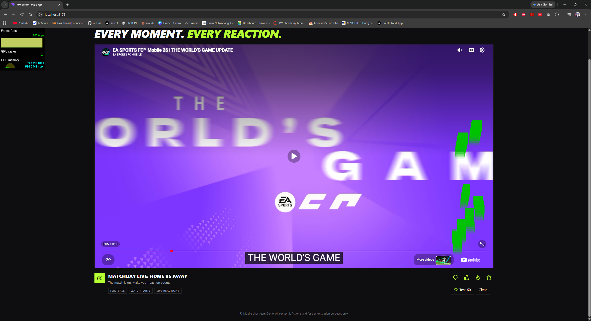
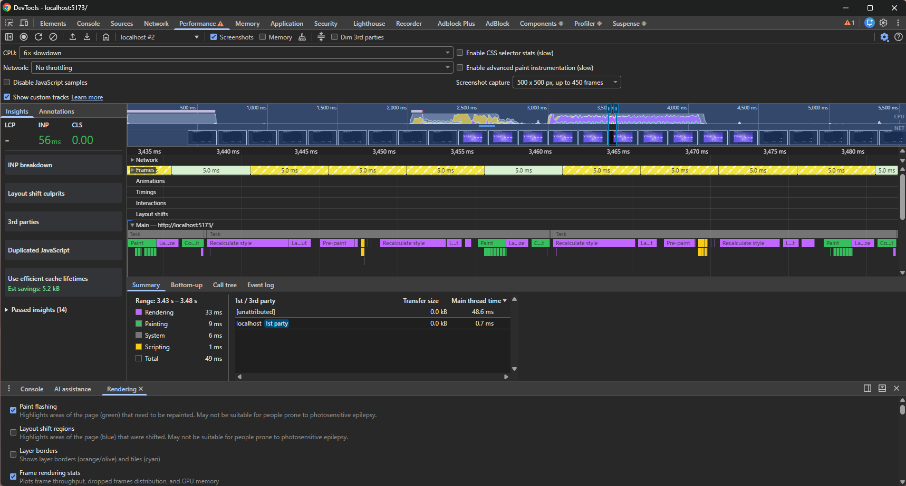
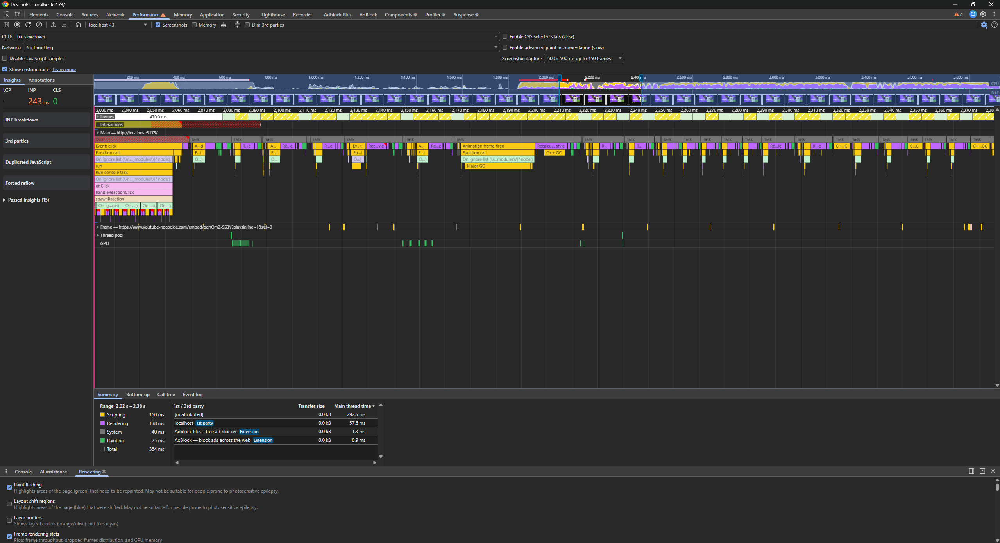

# Livestream Reaction Engine — Submission
Name: Chen Chor Yan\
Email: nicolechen119@gmail.com

## 1. Setup & Running Instructions
Install Node.js 22.12 or later and npm before running the project.
1. Open a terminal in the project folder:
   cd fcm-intern-challenge
2. Install dependencies:
   npm install
3. Start the development server:
   npm run dev
4. Open the URL displayed in the terminal, usually http://localhost:5173, in Google Chrome.
Click an icon to send a reaction, or Test 60 to create 60 reactions at once. Use the mode buttons to switch between CSS and GSAP. In GSAP mode, the speed slider changes the speed of the reactions.

An internet connection is required to load the embedded YouTube video.

### Test Conditions
- Browser: Google Chrome
- CPU throttling: 6× slowdown
- Load: 60 reactions spawned simultaneously
- Animation duration: 3 seconds
- Background video: Paused

## 2. Phase 1: CSS Keyframes Analysis 
* **Paint Flashing Screenshot:** 
* **Performance Profile Screenshot:** 

* **Observations:** 
* What regions of the screen flashed green during high-concurrency spawning, and why?\
The green highlights appeared on the floating reactions which starts at the bottom right of the video as they move upwards. The rest of the page did not show any visible highlights. This happens because the CSS animation changes bottom, left, width and height, so the browser is required to calculate the reactions’ new position and repaint the affected areas.

* What did the main thread activity (Layout, Recalculate Style, Paint) look like in the flame chart?\
With 6× CPU slowdown, the flame chart showed repeated purple Recalculate Style and Layout tasks, with the green Paint tasks. They appeared repeatedly when the reactions are moving. This shows that the browser was updating animated styles, calculating new positions and also repainting the reactions. This recurring tasks show that the keyframe animation required ongoing main thread rendering work.

## 3. Phase 2: GSAP & Composited Rendering Analysis 
* **Performance Profile Screenshot:** 
* **Observations:** 
* How did the flame chart and frame rate change compared to Phase 1?\
In Phase 2, the animation-frame callbacks are more detailed and noticeable in the flame chart because GSAP updates the animated properties on each frame while it runs. Some style recalculation, painting and garbage collection are still visible.

* What happened to the green paint invalidation areas once animations moved to composited transforms (`x`, `y`)?\
The green paint highlights were no longer visible. This is because the browser is moving the reactions through the composited transforms rather than repeatingly repainting them while their positions changed. Even so, creating and removing the reactions can still involve rendering work but no green highlights were observed.

## 4. Architectural Reflection 
* **Runtime Control & Developer Experience:** How does adjusting playback speed or randomizing flight paths mid-flight compare between static CSS rules and programmatic timelines?\
GSAP provides direct control over active reactions by using timelines. The active timelines are stored  and timeScale() is called on each timeline when the input slider is changed. It immediately adjusts playback speed while also preserving the animation progress. This prevents the reactions from restarting when the speed is changed.

Besides that, flight paths could also be changed by replacing the remaining movement tweens from the current position. CSS animations can also be adjusted through custom properties, but keeping the movement, size and fading in sync would require more manual handling. GSAP groups movement, scaling and fading into one controllable timeline, which makes these changes easier to organise.

* **Pipeline Considerations:** If our application needed to dynamically tint, re-theme, or alter these reaction assets at runtime based on active user preferences, what architectural considerations dictate choosing programmatic vector manipulation over pre-rendered raster image sequences?\
In this case, the reaction’s shape should be separated from its appearance and animation. SVG would help to define the shape and user preferences would supply values such as colour, and the animation engine would control its movement. This would allow the application reuse the same asset while applying each user’s selected theme at runtime.

With pre-rendered raster sequences, supporting different colours, sizes or appearances can require additional animation frames. If the customisation options increase, this would also increase the download size, decoded image memory and maintenance work. Therefore, programmatic SVG manipulation would make it easier for us to change colours or individual parts without preparing every combination in advance.

The rendering cost should also be considered. Complex SVG or frequent changes to the paths and colours can trigger repainting. For these simple reactions, I would apply the user’s appearance settings when creating the SVG, then animate its wrapper using transforms and opacity. For complex effects with a fixed appearance, pre-rendered raster sequences can be more suitable.